<p align="center">
  
</p>

<p align="center">
  <a href="https://www.linkedin.com/in/md-tanvir-khan-nova-5168b9351"></a>
  <a href="https://github.com/tanvirkhannova"></a>
  <a href="https://github.com/tanvirkhannova?tab=repositories"></a>
  <a href="https://github.com/tanvirkhannova?tab=followers"></a>
  
</p>

<p align="center">
  
</p>

<h3><code>~/tech-stack</code></h3>

<table>
  <tr>
    <td width="170"><code>[ Languages ]</code></td>
    <td></td>
  </tr>
  <tr>
    <td><code>[ Frontend ]</code></td>
    <td></td>
  </tr>
  <tr>
    <td><code>[ Backend &amp; Data ]</code></td>
    <td></td>
  </tr>
  <tr>
    <td><code>[ Cloud / DevOps ]</code></td>
    <td></td>
  </tr>
  <tr>
    <td><code>[ Sec / Tools ]</code></td>
    <td></td>
  </tr>
</table>

<h3><code>~/projects --featured</code></h3>

<p align="center">
  <a href="https://github.com/tanvirkhannova/nova-agent"></a>
  <a href="https://github.com/tanvirkhannova/50-python-projects"></a>
</p>
<p align="center">
  <a href="https://github.com/tanvirkhannova/nova-toolkit"></a>
</p>

<h3><code>~/expertise.json</code></h3>

```json
{
  "operator": "Tanvir Khan Nova",
  "alias": "nova",
  "base": "Finland (UTC+2)",
  "focus": ["web development", "automation", "linux", "security fundamentals"],
  "currently_learning": ["system design", "secure coding (OWASP Top 10)", "cloud & containers"],
  "workflow": "plan → build → break → fix → ship",
  "status": "open to collaborate",
  "fun_fact": "turns caffeine into commits"
}
```

<h3><code>~/system-stats</code></h3>

<p align="center">
  
  
</p>

<p align="center">
  
</p>

<p align="center">
  
</p>

<h3><code>~/snake --eat=contributions</code></h3>

<p align="center">
  
</p>

```diff
+ connection secure — thanks for visiting the mainframe.
- session will self-terminate in 3... 2... 1...
```
