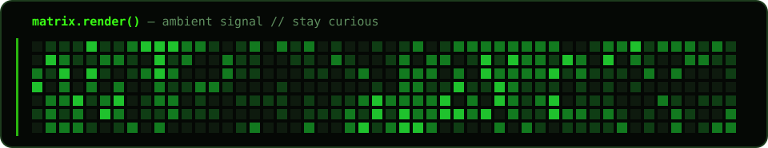

<p align="center">
  
</p>

<p align="center">
  <a href="https://github.com/tanvirkhannova"></a>
  <a href="https://github.com/tanvirkhannova?tab=repositories"></a>
  <a href="https://github.com/tanvirkhannova?tab=followers"></a>
  
</p>

<p align="center">
  
</p>

<h3><code>~/tech-stack</code></h3>

<table>
  <tr>
    <td width="170"><code>[ Languages ]</code></td>
    <td></td>
  </tr>
  <tr>
    <td><code>[ Frontend ]</code></td>
    <td></td>
  </tr>
  <tr>
    <td><code>[ Backend &amp; Data ]</code></td>
    <td></td>
  </tr>
  <tr>
    <td><code>[ Cloud / DevOps ]</code></td>
    <td></td>
  </tr>
  <tr>
    <td><code>[ Sec / Tools ]</code></td>
    <td></td>
  </tr>
</table>

<h3><code>~/expertise.json</code></h3>

```json
{
  "operator": "Tanvir Khan Nova",
  "alias": "nova",
  "base": "Finland (UTC+2)",
  "focus": ["web development", "automation", "linux", "security fundamentals"],
  "currently_learning": ["system design", "secure coding (OWASP Top 10)", "cloud & containers"],
  "workflow": "plan → build → break → fix → ship",
  "status": "open to collaborate",
  "fun_fact": "turns caffeine into commits"
}
```

<h3><code>~/system-stats</code></h3>

<p align="center">
  
  
</p>

<p align="center">
  
</p>

<p align="center">
  
</p>

```diff
+ connection secure — thanks for visiting the mainframe.
- session will self-terminate in 3... 2... 1...
```
<!-- root@nova :: profile.sys -->

<p align="center">
  
</p>

<p align="center">
  <a href="https://github.com/tanvirkhannova">
    
  </a>
</p>

<p align="center">
  
  
  
  <a href="https://github.com/tanvirkhannova?tab=followers"></a>
</p>

```
███╗   ██╗ ██████╗ ██╗   ██╗ █████╗
████╗  ██║██╔═══██╗██║   ██║██╔══██╗
██╔██╗ ██║██║   ██║██║   ██║███████║
██║╚██╗██║██║   ██║╚██╗ ██╔╝██╔══██║
██║ ╚████║╚██████╔╝ ╚████╔╝ ██║  ██║
╚═╝  ╚═══╝ ╚═════╝   ╚═══╝  ╚═╝  ╚═╝
```

### `> whoami`

```bash
┌──(nova㉿mainframe)-[~]
└─$ whoami
tanvir_khan_nova

┌──(nova㉿mainframe)-[~]
└─$ cat /etc/profile.conf
[ALIAS]      => Nova
[LOCATION]   => Finland // 60.17°N 24.94°E
[MINDSET]    => break it → understand it → build it better
[FUEL]       => caffeine, lo-fi, 3AM ideas
[MISSION]    => learn fast // build often // ship in public
[STATUS]     => [■■■■■■■■□□] 80% loading greatness...

┌──(nova㉿mainframe)-[~]
└─$ ./run_mission.sh --mode=unstoppable
[*] Scanning for new challenges ........... FOUND
[*] Deploying curiosity ................... DONE
[+] Ready to build. Let's connect.
```

### `> ls ./arsenal`

<p align="center">
  
</p>

### `> cat /var/log/activity.log`

<p align="center">
  
  
</p>

<p align="center">
  
</p>

<p align="center">
  
</p>

### `> trophy --list`

<p align="center">
  
</p>

---

```diff
+ "The quieter you become, the more you are able to hear."
- Connection will self-terminate in 3... 2... 1...
```

<p align="center">
  
</p>
<!-- ⚡ Profile README for tanvirkhannova -->

<p align="center">
  
</p>

<p align="center">
  <a href="https://github.com/tanvirkhannova">
    
  </a>
</p>

<p align="center">
  
  <a href="https://github.com/tanvirkhannova?tab=followers"></a>
  
</p>

---

### 🧬 About me

```js
const tanvir = {
  location:   "Finland 🇫🇮",
  mission:    "Learn fast, build often, ship in public",
  fuel:       ["☕ coffee", "🎧 lo-fi", "🌌 curiosity"],
  currently:  "Starting my GitHub journey — first repos incoming 🚀",
  askMeAbout: ["tech", "ideas", "anything worth building"],
};
```

### 🛠️ Toolbox I'm exploring

<p align="center">
  
</p>

### 📊 GitHub stats

<p align="center">
  
  
</p>

<p align="center">
  
</p>

<p align="center">
  
</p>

### 🏆 Trophies

<p align="center">
  
</p>

---

<p align="center">
  <i>"Every expert was once a beginner who refused to quit."</i>
</p>

<p align="center">
  
</p>
